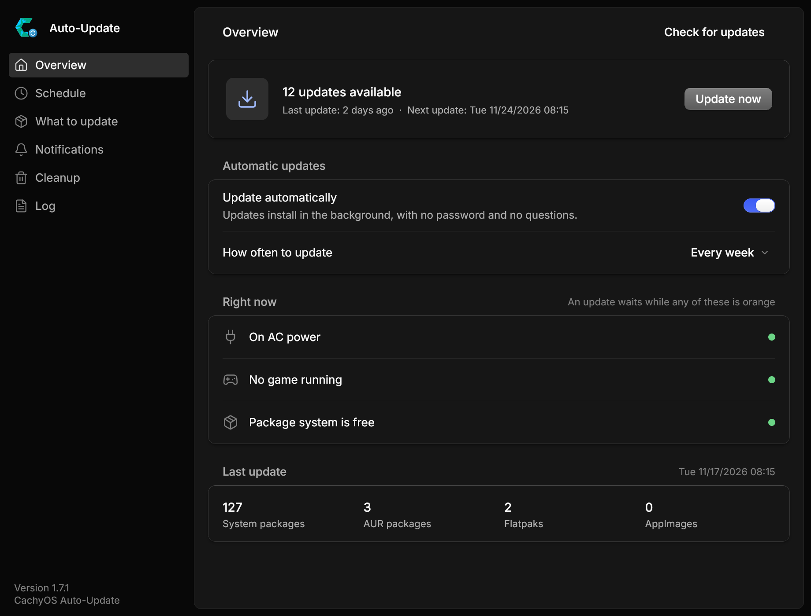
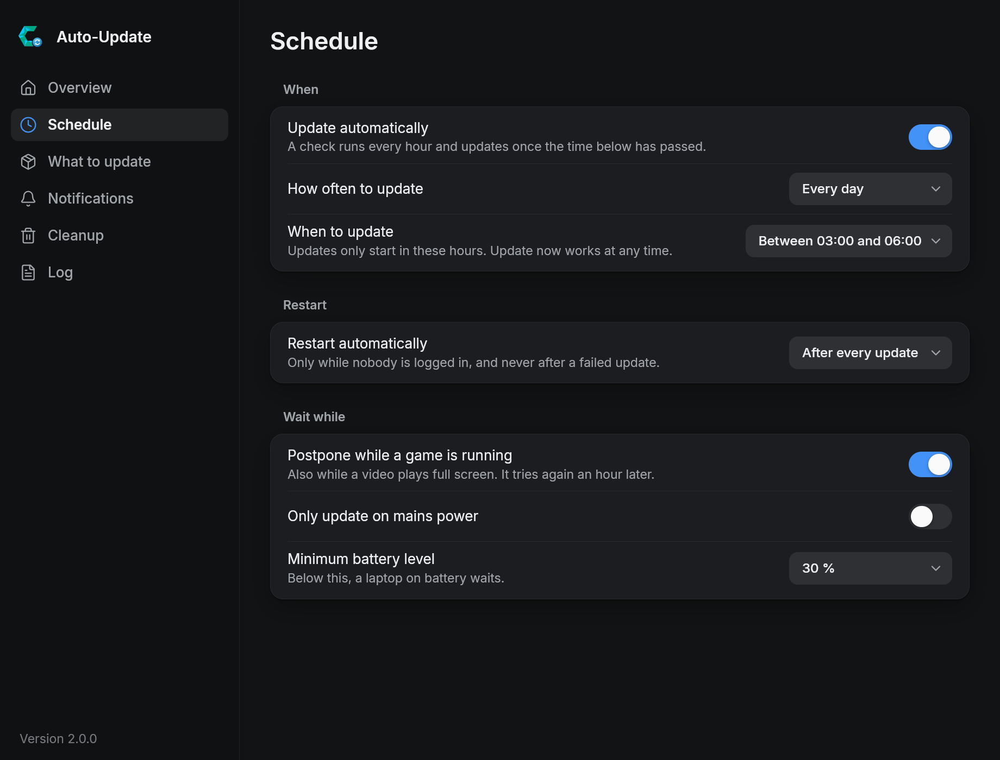
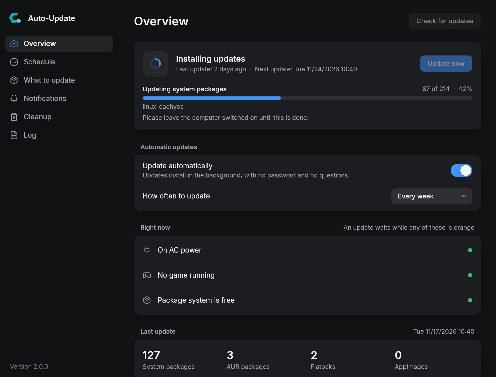
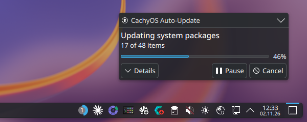
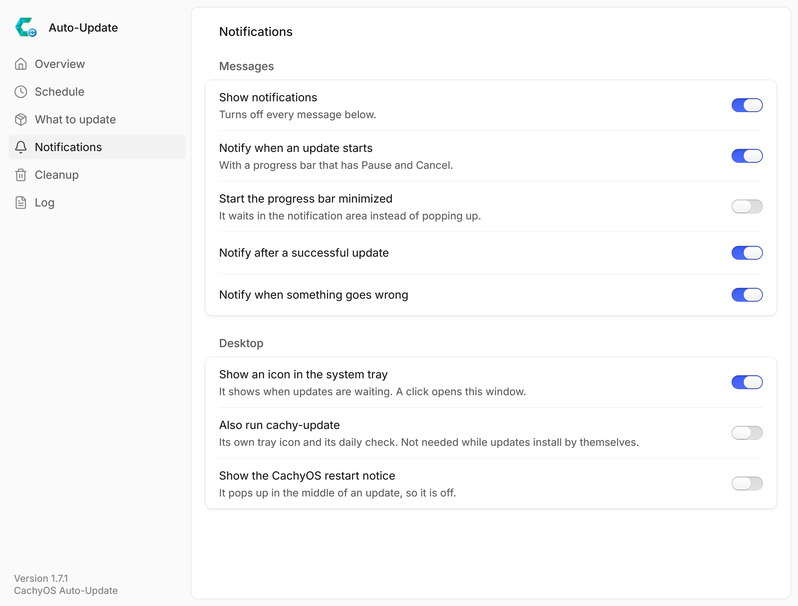

<p align="center">
  
</p>

<h1 align="center">cachy-auto-update</h1>

<h3 align="center">Unattended background updates for CachyOS.</h3>

<p align="center">
  pacman, AUR, Flatpak and AppImages. In the background, with no password prompt.
</p>

<h5 align="center">
  <a href="#install">Install</a> |
  <a href="#how-to-use">How to use</a> |
  <a href="https://github.com/LoonixTools/cachy-auto-update/issues">Report a bug</a>
</h5>

<p align="center">
  <a href="https://ko-fi.com/felitendo"></a>
</p>

## Install

1. Install the package from the AUR:

   ```bash
   paru -S cachy-auto-update
   ```

   paru first asks to show the build files. Press **q** to close them, then **Enter** to install.
   No paru yet? Get it with `sudo pacman -S paru`.

2. Turn automatic updates on: open **CachyOS Auto-Update** from the application menu and switch on
   **Update automatically**. Or in a terminal:

   ```bash
   sudo cachy-auto-update enable
   ```

## How to use

Open **CachyOS Auto-Update** from the application menu, or run `cachy-auto-update`.

<p align="center">
  
</p>

**Overview** shows if updates are waiting, with an **Update now** button. It also says why an update would
wait right now, for example a game or low battery. The other pages on the left hold all the settings.

Changing a setting asks for your password once, then not again for a few minutes.

Updates run once a week. To change that, use **How often to update**.

### Restart

Nothing restarts on its own, unless you turn on **Restart automatically** under **Schedule**. Pick
**After a kernel update** or **After every update**. Handy for a home server.

<p align="center">
  
</p>

It only restarts after an update that went through, and only while nobody is logged in to the desktop.
Until then it waits. People on a terminal or over SSH get a message two minutes before, and
`sudo shutdown -c` stops it.

From the command line: `sudo cachy-auto-update config set AutoReboot needed` (or `always`, or `no`).

### Tray icon

An icon in the system tray shows if updates are waiting. Click it to open the window.
Right-click it for **Update now**, **Check for updates**, **Show log** and **Settings**.

Do not want it? Turn off **Show an icon in the system tray** under **Notifications**.

While an update runs, the window shows how far it is.

<p align="center">
  
</p>

A progress bar in the notification area shows it too. You can **Pause** or **Cancel** the update there.

<p align="center">
  
</p>

To keep it out of the way, turn on **Start the progress bar minimized** under **Notifications**. The bar then
stays in the notification area and does not pop up. Click the notification icon to see it.

<p align="center">
  
</p>

### Command line

```bash
cachy-auto-update status       # how things stand
sudo cachy-auto-update run     # update now
cachy-auto-update config list  # every setting
```

`cachy-auto-update --help` lists everything.

## When does it update?

| | |
|---|---|
| Once a week | ✅ Updates (change it in the settings) |
| Battery below 30 % | ⏸️ Waits (on power it runs) |
| A game is running | ⏸️ Waits |
| pacman, yay or paru is running | ⏸️ Waits |
| Shutdown or suspend during an update | 🚫 Blocked until it is done, or until you click **Cancel** |
| Restart after an update | ❌ Not on its own. The window and the tray icon say when one is due. Turn on **Restart automatically** to change that |

## More

<details>
<summary>What it updates</summary>

| | |
|---|---|
| Packages | `pacman -Syu` |
| AUR | `paru` or `yay` |
| Flatpak | system and user installs |
| AppImages | through [Gear Lever](https://github.com/mijorus/gearlever) |

</details>

<details>
<summary>Safety</summary>

- A progress bar shows the step and the package.
- **Cancel** and **Pause** on the progress bar never stop pacman while it installs. They wait until that part is done.
- On Btrfs with snapper (the CachyOS default) every update gets a snapshot before and after.
- A lock file left by a power cut is removed on the next run.
- Package replacements are handled on their own. File conflicts are never overwritten.
- A signature error refreshes the keyring once and tries again.
- An AUR package that does not build is held back. Everything else still updates.
- Old package versions and AUR build leftovers are cleaned up, so the caches do not fill the disk.

</details>

<details>
<summary>Logs</summary>

```bash
cachy-auto-update log        # last run
cachy-auto-update log -a     # all runs
journalctl -u cachy-auto-update
```

</details>

<details>
<summary>cachy-update</summary>

[cachy-update](https://github.com/CachyOS/cachy-update) tells you about updates, you install them.
This installs them for you, so cachy-update's tray icon and notifications are turned off while automatic
updates are on. So is the **Reboot recommended** pop-up of CachyOS, because it shows up in the middle of an
update. To keep them, turn on **Also run cachy-update** or **Show the CachyOS restart notice** under
**Notifications**.

</details>

<details>
<summary>Build from source</summary>

Written in Rust. The window is drawn with [Rune](https://github.com/anomalyco/rune).

```bash
make && sudo make install
sudo systemd-sysusers && sudo systemd-tmpfiles --create
sudo cachy-auto-update enable
```

Building needs `rust`, `libxkbcommon` and `wayland`. Optional at run time: `pacman-contrib`, an AUR helper,
`flatpak`, Gear Lever.

</details>

GPL-3.0-or-later.
